# Results index (bench data)

Generated by `python src/run_pipeline.py`. Do not edit by hand.

Runs used in the fit: R1, R2, R3. Weighted residual variance s^2 = 1.002 (close to 1 means the model fits to within the noise).

## Key numbers

| parameter     | units       |   estimate |   std_error |   ci95_low |   ci95_high |   rel_95CI_% |
|:--------------|:------------|-----------:|------------:|-----------:|------------:|-------------:|
| k_ref @ 315 K | L/(mol min) |    0.01964 |   5.765e-05 |    0.01953 |     0.01976 |       0.5756 |
| Ea            | kJ/mol      |   57.7     |   0.1427    |   57.42    |    57.98    |       0.485  |
| dH_rxn        | kJ/mol      |  -83.6     |   0.3527    |  -84.29    |   -82.91    |       0.8274 |

Recommended design (target X_A = 0.95 in 240 min):

| quantity                    | value   | units   |
|:----------------------------|:--------|:--------|
| Feed policy                 | staged  |         |
| Feed time                   | 125     | min     |
| Coolant temperature         | 40      | C       |
| Jacket UA                   | 168     | W/K     |
| Conversion at end of batch  | 0.953   | -       |
| Peak temperature            | 71.2    | C       |
| Highest MTSR                | 80.3    | C       |
| Margin to the failure limit | 13.8    | K       |

## Figures

| File | Report | What it shows |
|---|---|---|
| [fig01_fit_runs.png](figures/fig01_fit_runs.png) | Part 6 | Fitted model (lines) against the bench measurements (points) for every fitting run. Top: concentrations; bottom: temperature; dotted line: feed stops. |
| [fig02_fit_residuals.png](figures/fig02_fit_residuals.png) | Part 6 | Residuals (data minus model) against time. Random scatter about zero means the model explains the data to within the measurement noise. |
| [fig04_plant_nominal_profiles.png](figures/fig04_plant_nominal_profiles.png) | Part 8 | 1000 L reactor, nominal case, against time: conversion of A, reactor temperature with the MTSR (cooling-loss ceiling), the three heat flows (reaction, jacket, cold feed) and the concentrations. |
| [fig05_bench_vs_plant.png](figures/fig05_bench_vs_plant.png) | Part 8 | Same recipe at bench and plant scale. The plant runs hotter because jacket area grows as V^(2/3) while heat release grows as V. |
| [fig06_feed_rate_scan.png](figures/fig06_feed_rate_scan.png) | Part 9 | Left: peak temperature (normal operation) and MTSR (cooling loss) against feed rate, with both safety limits; this sets the maximum safe feed rate. Right: Morbidelli-Varma sensitivity s = d ln T_max / d ln q; a sharp peak marks the runaway boundary. |
| [fig07_cooling_failure.png](figures/fig07_cooling_failure.png) | Part 9 | Total cooling loss during the nominal batch. Left: peak temperature reached against the time of failure, with and without the feed interlock, and the MTSR at that time. Right: temperature profiles for the worst failure time. |
| [fig08_runaway_map_q_vs_UA.png](figures/fig08_runaway_map_q_vs_UA.png) | Part 9 | Runaway map over feed rate and jacket UA. Green: safe; red: unsafe. Blue line: peak-temperature limit; orange dashed: MTSR limit; black: peak-temperature contours. |
| [fig09_runaway_map_q_vs_Tc.png](figures/fig09_runaway_map_q_vs_Tc.png) | Part 9 | Runaway map over feed rate and coolant temperature, same colour code as fig08. |
| [fig10_conversion_vs_UA.png](figures/fig10_conversion_vs_UA.png) | Part 10 | Best safe conversion reachable at each jacket UA; the recommended design is the smallest UA that meets the target. |
| [fig11_recommended_design.png](figures/fig11_recommended_design.png) | Part 10 | Recommended design: feed-rate schedule, temperature, MTSR and conversion in normal operation, and the worst-case cooling failure with and without the interlock. |
| [fig12_monte_carlo.png](figures/fig12_monte_carlo.png) | Part 11 | Monte Carlo over the fitted-parameter uncertainty: spread of conversion and MTSR for the recommended design. |

### fig01_fit_runs (Part 6)

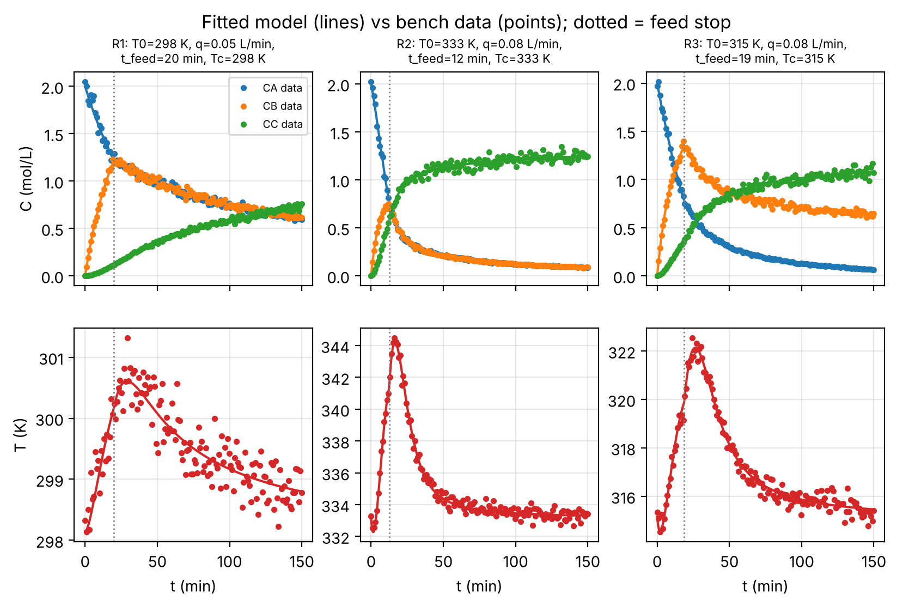

Fitted model (lines) against the bench measurements (points) for every fitting run. Top: concentrations; bottom: temperature; dotted line: feed stops.

### fig02_fit_residuals (Part 6)

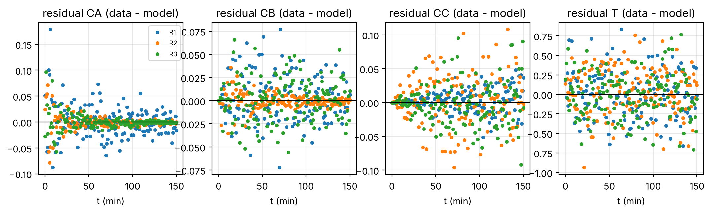

Residuals (data minus model) against time. Random scatter about zero means the model explains the data to within the measurement noise.

### fig04_plant_nominal_profiles (Part 8)

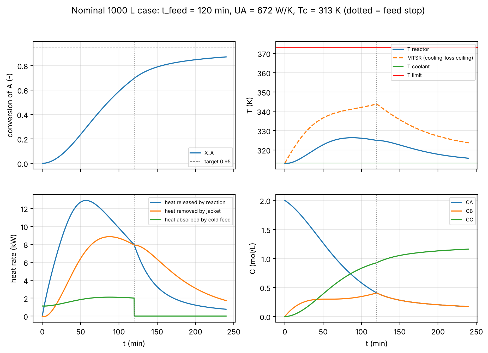

1000 L reactor, nominal case, against time: conversion of A, reactor temperature with the MTSR (cooling-loss ceiling), the three heat flows (reaction, jacket, cold feed) and the concentrations.

### fig05_bench_vs_plant (Part 8)

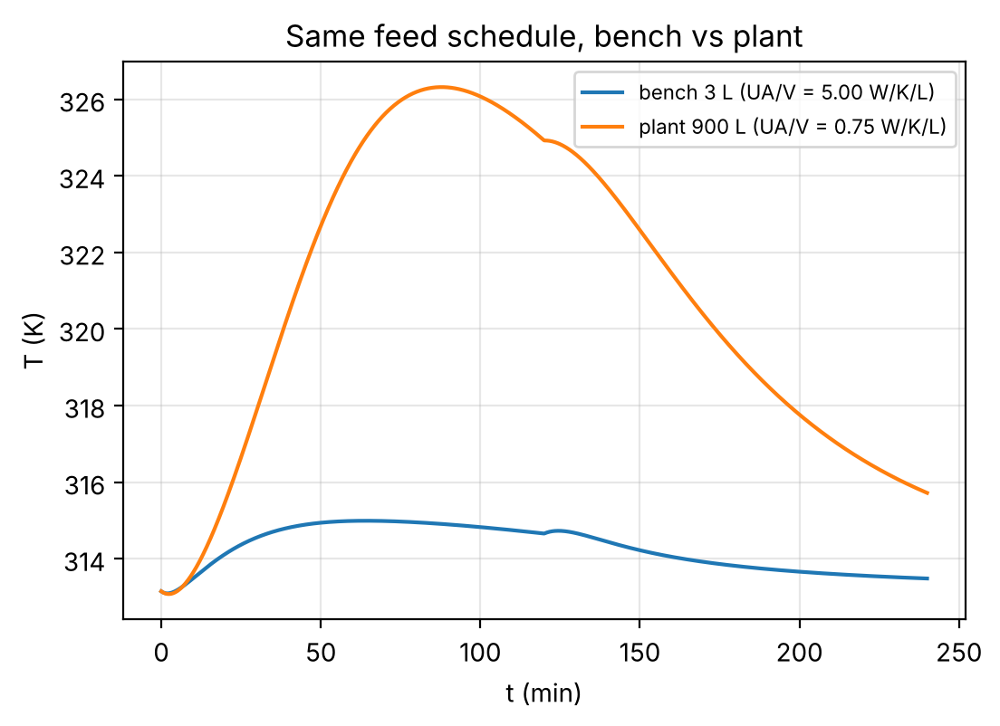

Same recipe at bench and plant scale. The plant runs hotter because jacket area grows as V^(2/3) while heat release grows as V.

### fig06_feed_rate_scan (Part 9)

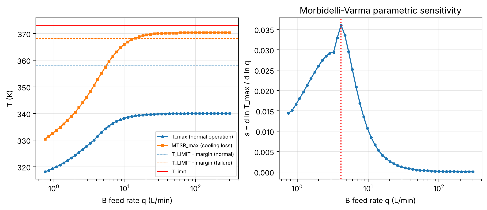

Left: peak temperature (normal operation) and MTSR (cooling loss) against feed rate, with both safety limits; this sets the maximum safe feed rate. Right: Morbidelli-Varma sensitivity s = d ln T_max / d ln q; a sharp peak marks the runaway boundary.

### fig07_cooling_failure (Part 9)

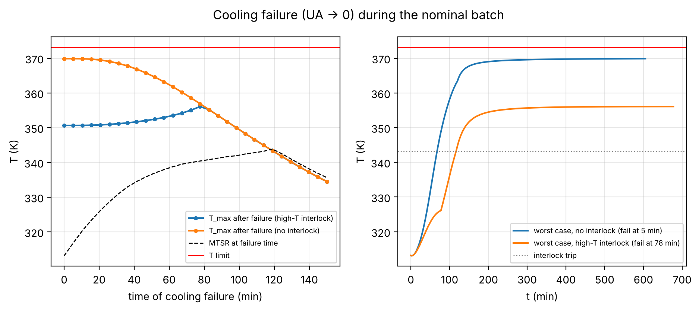

Total cooling loss during the nominal batch. Left: peak temperature reached against the time of failure, with and without the feed interlock, and the MTSR at that time. Right: temperature profiles for the worst failure time.

### fig08_runaway_map_q_vs_UA (Part 9)

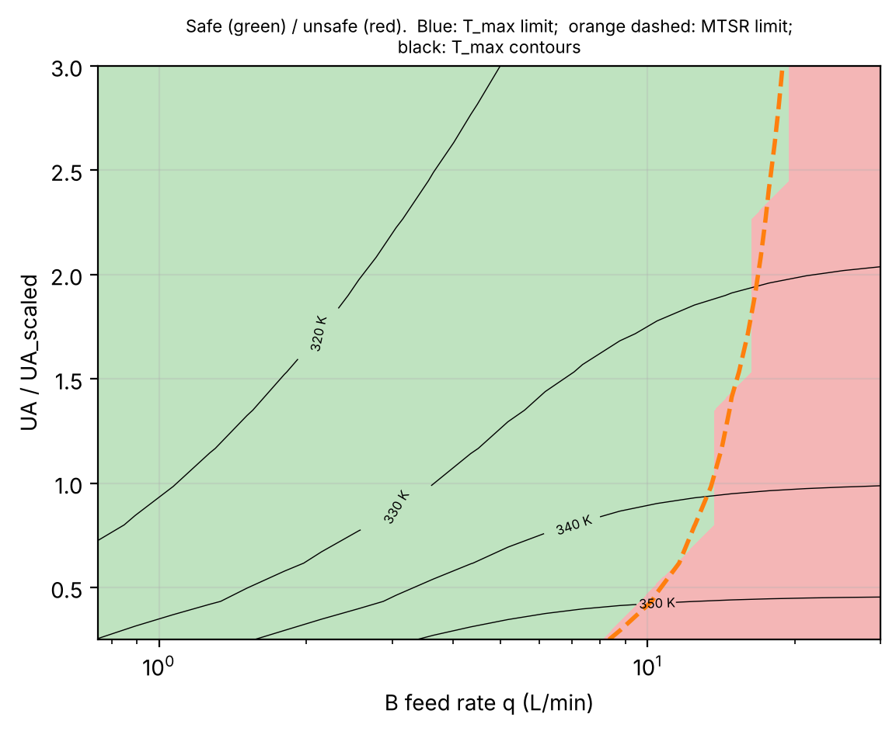

Runaway map over feed rate and jacket UA. Green: safe; red: unsafe. Blue line: peak-temperature limit; orange dashed: MTSR limit; black: peak-temperature contours.

### fig09_runaway_map_q_vs_Tc (Part 9)

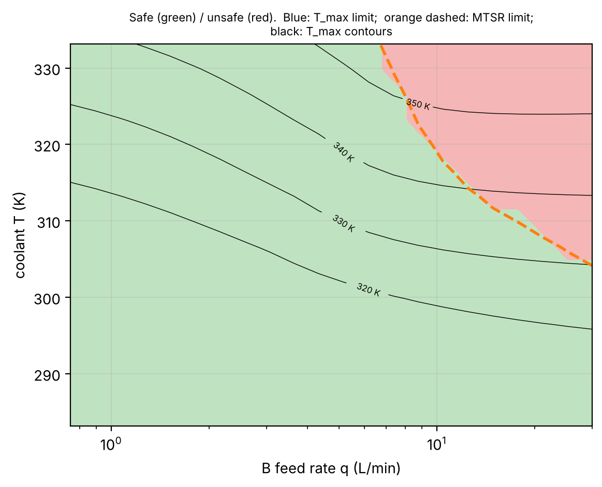

Runaway map over feed rate and coolant temperature, same colour code as fig08.

### fig10_conversion_vs_UA (Part 10)

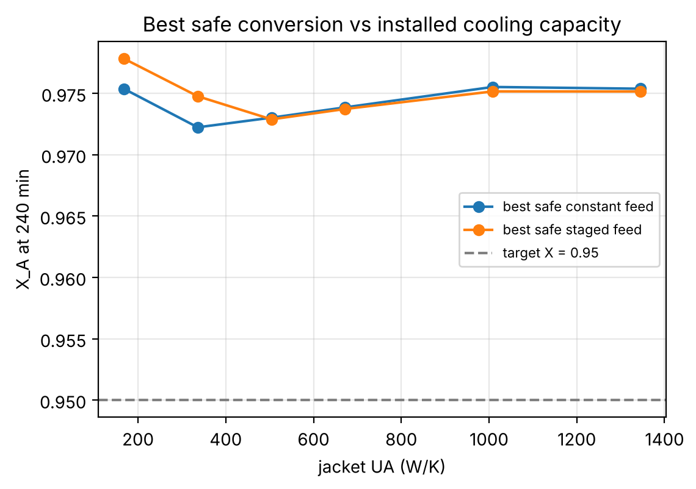

Best safe conversion reachable at each jacket UA; the recommended design is the smallest UA that meets the target.

### fig11_recommended_design (Part 10)

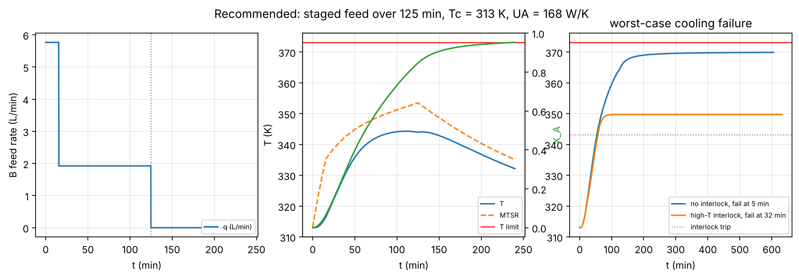

Recommended design: feed-rate schedule, temperature, MTSR and conversion in normal operation, and the worst-case cooling failure with and without the interlock.

### fig12_monte_carlo (Part 11)

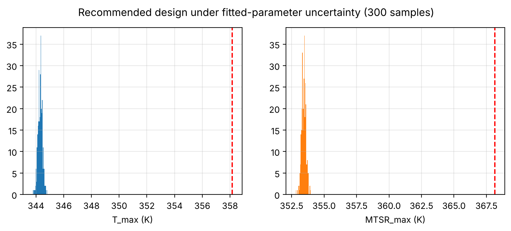

Monte Carlo over the fitted-parameter uncertainty: spread of conversion and MTSR for the recommended design.

## Tables

| File | Report | What it holds |
|---|---|---|
| [ENCH421_Results_by_Run.xlsx](tables/ENCH421_Results_by_Run.xlsx) | Appendix C | Workbook: every run with its calculations and charts. |
| [appendixE_worked_examples.json](tables/appendixE_worked_examples.json) | Appendix E | Numbers used in the hand calculations. |
| [part10_best_design_per_UA.csv](tables/part10_best_design_per_UA.csv) | Part 10 | Best design found at each jacket UA. |
| [part10_design_scenarios.csv](tables/part10_design_scenarios.csv) | Part 10 | Recommended design for other conversion targets and batch times. |
| [part10_design_summary.json](tables/part10_design_summary.json) | Part 10 | Table 7: the recommended design. |
| [part10_recommended_cooling_failure.csv](tables/part10_recommended_cooling_failure.csv) | Part 10 | Cooling-failure scan for the recommended design. |
| [part10_trip_sweep.csv](tables/part10_trip_sweep.csv) | Part 10, 12 | Trip setting against nuisance trips and the worst cooling-failure peak, for three candidate designs. |
| [part11_sensitivity.csv](tables/part11_sensitivity.csv) | Part 11 | Effect of Ea +/- 10 % and UA - 20 % on the recommended design. |
| [part4_verification_checks.csv](tables/part4_verification_checks.csv) | Part 4 | Table 3: verification checks (conservation, analytic limits, tolerance convergence, MTSR consistency). |
| [part5_candidates_after_1_runs.csv](tables/part5_candidates_after_1_runs.csv) | Part 5 | Every candidate next run, ranked by information gain, after the safety screen. |
| [part5_candidates_after_3_runs.csv](tables/part5_candidates_after_3_runs.csv) | Part 5 | Every candidate next run, ranked by information gain, after the safety screen. |
| [part5_next_2_runs_after_1.csv](tables/part5_next_2_runs_after_1.csv) | Part 5 | Recommended batch of next runs, chosen jointly (greedy D-optimal). |
| [part5_next_2_runs_after_3.csv](tables/part5_next_2_runs_after_3.csv) | Part 5 | Recommended batch of next runs, chosen jointly (greedy D-optimal). |
| [part6_fitted_parameters.csv](tables/part6_fitted_parameters.csv) | Part 6 | Table 5: fitted parameters with standard errors and 95 % CIs. |
| [part6_parameter_correlation.csv](tables/part6_parameter_correlation.csv) | Part 6 | Correlation between the fitted parameters. |
| [part8_nominal_summary.json](tables/part8_nominal_summary.json) | Part 8 | Nominal full-scale case: conditions and key results. |
| [part9_cooling_failure_scan.csv](tables/part9_cooling_failure_scan.csv) | Part 9 | Outcome of cooling loss at each failure time. |
| [part9_feed_rate_scan.csv](tables/part9_feed_rate_scan.csv) | Part 9 | Peak temperature, MTSR and conversion for each feed time. |
| [part9_safety_summary.json](tables/part9_safety_summary.json) | Part 9 | Safety criterion, maximum safe feed rate, criticality class. |

### part4_verification_checks

| check                             | case       |      value |   tolerance | units    | passed   |
|:----------------------------------|:-----------|-----------:|------------:|:---------|:---------|
| N_A + N_C = N_A0                  | bench      |  4.441e-16 |      1e-06  | relative | True     |
| N_B + N_C = B fed                 | bench      |  1.178e-10 |      1e-06  | relative | True     |
| V = V0 + volume fed               | bench      |  5.89e-11  |      1e-06  | relative | True     |
| adiabatic energy balance          | bench      |  5.326e-10 |      1e-06  | relative | True     |
| isothermal post-feed analytic C_A | bench      |  1.963e-10 |      1e-05  | relative | True     |
| tolerance convergence: T          | bench      |  0.0001042 |      0.01   | K        | True     |
| tolerance convergence: X_A        | bench      |  5.326e-07 |      0.0001 | -        | True     |
| adiabatic failure T_final = MTSR  | bench      | -2.134e-07 |      0.05   | K        | True     |
| N_A + N_C = N_A0                  | full scale |  1.326e-15 |      1e-06  | relative | True     |
| N_B + N_C = B fed                 | full scale |  9.474e-16 |      1e-06  | relative | True     |
| V = V0 + volume fed               | full scale |  2.179e-15 |      1e-06  | relative | True     |
| adiabatic energy balance          | full scale |  4.804e-11 |      1e-06  | relative | True     |
| isothermal post-feed analytic C_A | full scale |  6.612e-10 |      1e-05  | relative | True     |
| tolerance convergence: T          | full scale |  0.0001254 |      0.01   | K        | True     |
| tolerance convergence: X_A        | full scale |  1.425e-06 |      0.0001 | -        | True     |
| adiabatic failure T_final = MTSR  | full scale | -8.648e-09 |      0.05   | K        | True     |

### part11_sensitivity

| case          |   fixed_XA |   fixed_Tmax |   fixed_MTSR |   fixed_margin_K | fixed_safe   | reopt_policy   |   reopt_t_feed |   reopt_Tc |   reopt_UA_W_K |   reopt_XA | reopt_meets_target   |
|:--------------|-----------:|-------------:|-------------:|-----------------:|:-------------|:---------------|---------------:|-----------:|---------------:|-----------:|:---------------------|
| base          |     0.9525 |        344.3 |        353.4 |            13.85 | True         | staged         |         124.9  |      313.1 |          168.1 |     0.9525 | True                 |
| Ea -10%       |     0.9447 |        343.6 |        354   |            14.19 | True         | staged         |          98.68 |      313.1 |          168.1 |     0.9545 | True                 |
| Ea +10%       |     0.9592 |        344.9 |        352.9 |            13.24 | True         | staged         |          98.68 |      303.1 |          168.1 |     0.9508 | True                 |
| plant UA -20% |     0.9607 |        347.5 |        355.9 |            10.69 | True         | staged         |          98.68 |      303.1 |          134.4 |     0.951  | True                 |

### part10_design_scenarios

|   target_X |   batch_min | meets_target   | policy   |   t_feed_min |   Tc_C |   UA_W_K |    X_A |   T_peak_C |   MTSR_max_C |   margin_K |   P_unsafe |   MTSR_p95_C |   X_A_p05 |
|-----------:|------------:|:---------------|:---------|-------------:|-------:|---------:|-------:|-----------:|-------------:|-----------:|-----------:|-------------:|----------:|
|       0.95 |         240 | True           | staged   |        124.9 |     40 |    168.1 | 0.9525 |      71.15 |        80.29 |      13.85 |          0 |        80.57 |    0.9521 |
|       0.92 |         240 | True           | staged   |        124.9 |     30 |    168.1 | 0.9298 |      63.48 |        74.85 |      20.15 |          0 |        75.13 |    0.9291 |
|       0.9  |         240 | True           | staged   |        158   |     30 |    168.1 | 0.9114 |      61.03 |        70.22 |      23.97 |          0 |        70.46 |    0.9107 |
|       0.95 |         300 | True           | staged   |        158   |     40 |    168.1 | 0.9512 |      68.09 |        76.44 |      16.91 |          0 |        76.7  |    0.9509 |
|       0.95 |         360 | True           | constant |        200   |     40 |    168.1 | 0.9512 |      66.29 |        75.46 |      18.71 |          0 |        75.71 |    0.9509 |
