# Results index (synthetic self-test)

Generated by `python src/run_pipeline.py --dataset synthetic`. Do not edit by hand.

> SYNTHETIC DATA. This folder only proves the code recovers known parameters. None of these numbers go in the report.

**Parameters: Fit 2 (runs S1, S2, S3, S4, S5).** Design target X_A = 0.95 in 240 min, trip 80 C (target still under group decision D2).

Runs used in the fit: S1, S2, S3, S4, S5. Weighted residual variance s^2 = 1.004 (close to 1 means the model fits to within the noise).

## Key numbers

| parameter     | units       |   estimate |   std_error |   ci95_low |   ci95_high |   rel_95CI_% |
|:--------------|:------------|-----------:|------------:|-----------:|------------:|-------------:|
| k_ref @ 310 K | L/(mol min) |    0.06789 |   0.0005463 |    0.06682 |     0.06897 |        1.58  |
| Ea            | kJ/mol      |   64.41    |   0.5008    |   63.43    |    65.39    |        1.526 |
| dH_rxn        | kJ/mol      |  -90.2     |   0.7078    |  -91.59    |   -88.81    |        1.54  |

Recommended design (target X_A = 0.95 in 240 min):

| quantity                    | value   | units   |
|:----------------------------|:--------|:--------|
| Feed policy                 | staged  |         |
| Feed time                   | 200     | min     |
| Coolant temperature         | 30      | C       |
| Jacket UA                   | 168     | W/K     |
| Conversion at end of batch  | 0.968   | -       |
| Peak temperature            | 59.9    | C       |
| Highest MTSR                | 63.6    | C       |
| Margin to the failure limit | 25.1    | K       |

## Figures

| File | Report | What it shows |
|---|---|---|
| [fig01_fit_runs.png](figures/fig01_fit_runs.png) | Part 6 | Fitted model (lines) against the bench measurements (points) for every fitting run. Top: concentrations; bottom: temperature; dotted line: feed stops. |
| [fig02_fit_residuals.png](figures/fig02_fit_residuals.png) | Part 6 | Residuals (data minus model) against time. Random scatter about zero means the model explains the data to within the measurement noise. |
| [fig03_validation_V1.png](figures/fig03_validation_V1.png) | Part 7 | Validation run predicted with the fitted parameters and no retuning. Shaded band: 95 % range from the parameter uncertainty. |
| [fig04_plant_nominal_profiles.png](figures/fig04_plant_nominal_profiles.png) | Part 8 | 1000 L reactor, nominal case, against time: conversion of A, reactor temperature with the MTSR (cooling-loss ceiling), the three heat flows (reaction, jacket, cold feed) and the concentrations. |
| [fig05_bench_vs_plant.png](figures/fig05_bench_vs_plant.png) | Part 8 | Same recipe at bench and plant scale. The plant runs hotter because jacket area grows as V^(2/3) while heat release grows as V. |
| [fig06_feed_rate_scan.png](figures/fig06_feed_rate_scan.png) | Part 9 | Left: peak temperature (normal operation) and MTSR (cooling loss) against feed rate, with both safety limits; this sets the maximum safe feed rate. Right: Morbidelli-Varma sensitivity s = d ln T_max / d ln q; a sharp peak marks the runaway boundary. |
| [fig07_cooling_failure.png](figures/fig07_cooling_failure.png) | Part 9 | Total cooling loss during the nominal batch. Left: peak temperature reached against the time of failure, with and without the feed interlock, and the MTSR at that time. Right: temperature profiles for the worst failure time. |
| [fig08_runaway_map_q_vs_UA.png](figures/fig08_runaway_map_q_vs_UA.png) | Part 9 | Runaway map over feed rate and jacket UA. Green: safe; red: unsafe. Blue line: peak-temperature limit; orange dashed: MTSR limit; black: peak-temperature contours. |
| [fig09_runaway_map_q_vs_Tc.png](figures/fig09_runaway_map_q_vs_Tc.png) | Part 9 | Runaway map over feed rate and coolant temperature, same colour code as fig08. |
| [fig10_conversion_vs_UA.png](figures/fig10_conversion_vs_UA.png) | Part 10 | Best safe conversion reachable at each jacket UA. The recommended design is chosen at the installed jacket (config.UA_SELECTION). |
| [fig11_recommended_design.png](figures/fig11_recommended_design.png) | Part 10 | Recommended design: feed-rate schedule, temperature, MTSR and conversion in normal operation, and the worst-case cooling failure with and without the interlock. |
| [fig12_monte_carlo.png](figures/fig12_monte_carlo.png) | Part 11 | Monte Carlo over the fitted-parameter uncertainty: spread of conversion and MTSR for the recommended design. |

### fig01_fit_runs (Part 6)

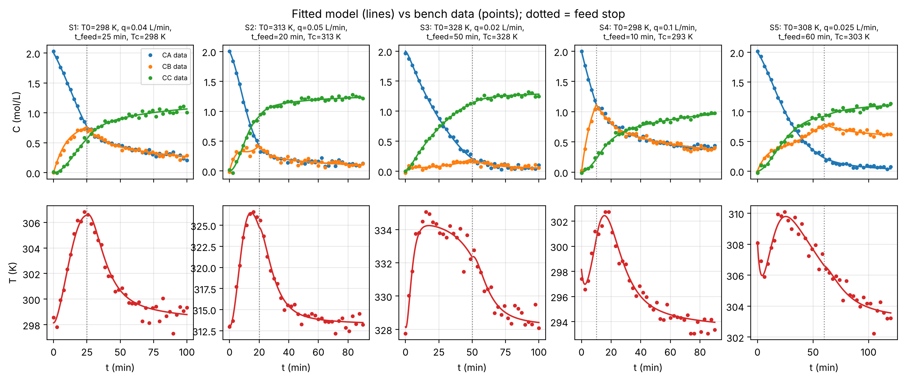

Fitted model (lines) against the bench measurements (points) for every fitting run. Top: concentrations; bottom: temperature; dotted line: feed stops.

**Finding: one parameter set fits all 5 runs with s^2 = 1.004; E_a = 64.4 kJ/mol (95 % CI within +/-1.5 %).**

### fig02_fit_residuals (Part 6)

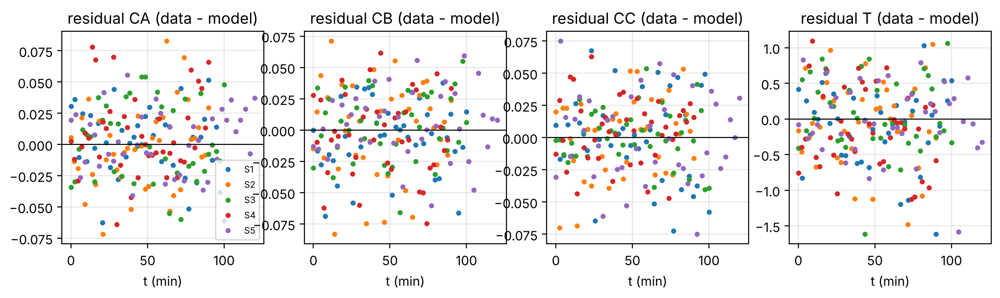

Residuals (data minus model) against time. Random scatter about zero means the model explains the data to within the measurement noise.

**Finding: no trend in any run or variable: |mean residual| <= 0.28 sigma, |lag-1 autocorrelation| <= 0.44.**

### fig03_validation_V1 (Part 7)

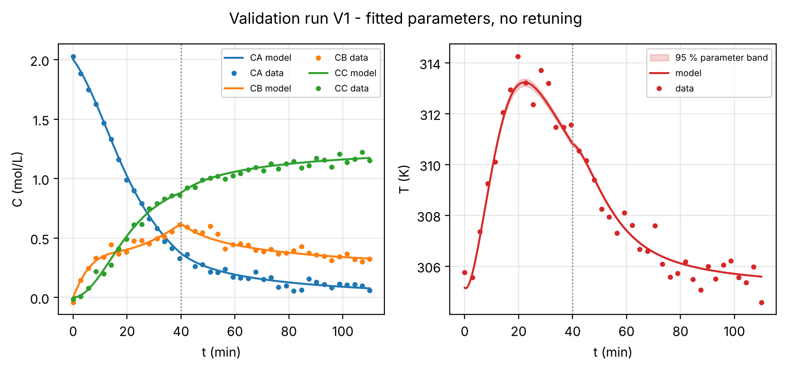

Validation run predicted with the fitted parameters and no retuning. Shaded band: 95 % range from the parameter uncertainty.

### fig04_plant_nominal_profiles (Part 8)

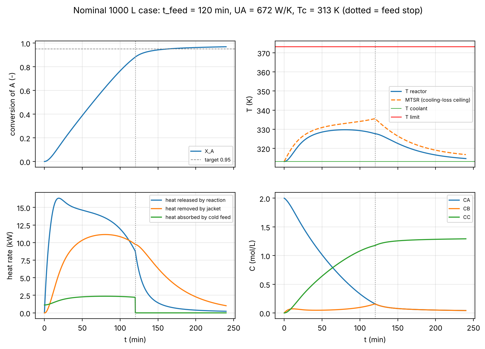

1000 L reactor, nominal case, against time: conversion of A, reactor temperature with the MTSR (cooling-loss ceiling), the three heat flows (reaction, jacket, cold feed) and the concentrations.

**Finding: the nominal recipe reaches X_A = 0.969 at 240 min with T_max = 56.6 C and MTSR up to 62.4 C.**

### fig05_bench_vs_plant (Part 8)

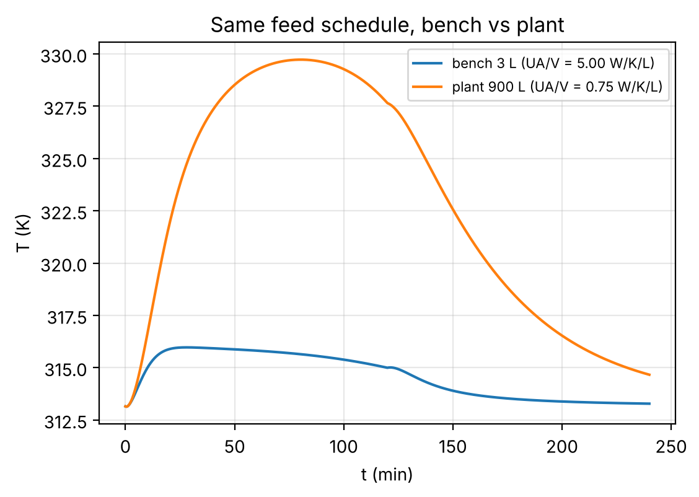

Same recipe at bench and plant scale. The plant runs hotter because jacket area grows as V^(2/3) while heat release grows as V.

**Finding: UA per litre falls from 5.00 to 0.75 W/(K L) on scale-up, so the plant runs 13.8 K hotter on the same schedule.**

### fig06_feed_rate_scan (Part 9)

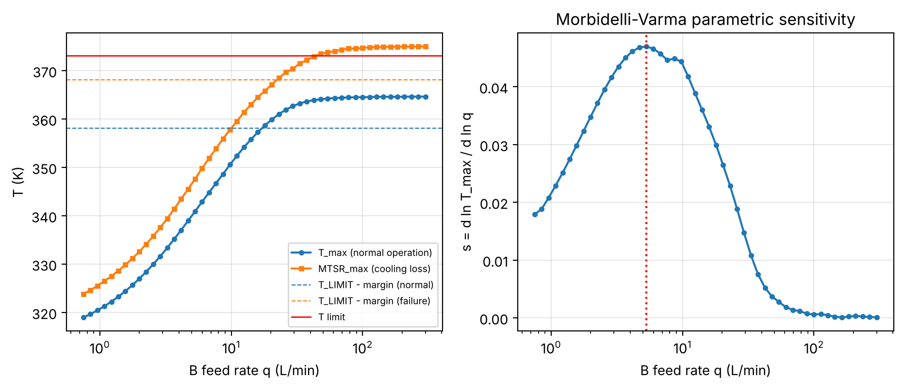

Left: peak temperature (normal operation) and MTSR (cooling loss) against feed rate, with both safety limits; this sets the maximum safe feed rate. Right: Morbidelli-Varma sensitivity s = d ln T_max / d ln q; a sharp peak marks the runaway boundary.

**Finding: the MTSR criterion limits the feed to 20.36 L/min; the Morbidelli-Varma sensitivity peak is at 5.31 L/min.**

### fig07_cooling_failure (Part 9)

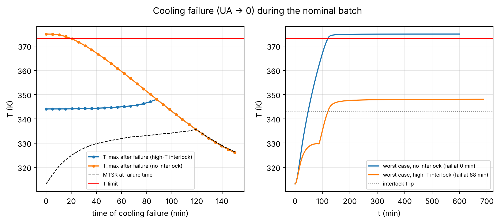

Total cooling loss during the nominal batch. Left: peak temperature reached against the time of failure, with and without the feed interlock, and the MTSR at that time. Right: temperature profiles for the worst failure time.

**Finding: worst cooling failure reaches 101.8 C if the feed continues and 74.9 C with the 80 C feed trip.**

### fig08_runaway_map_q_vs_UA (Part 9)

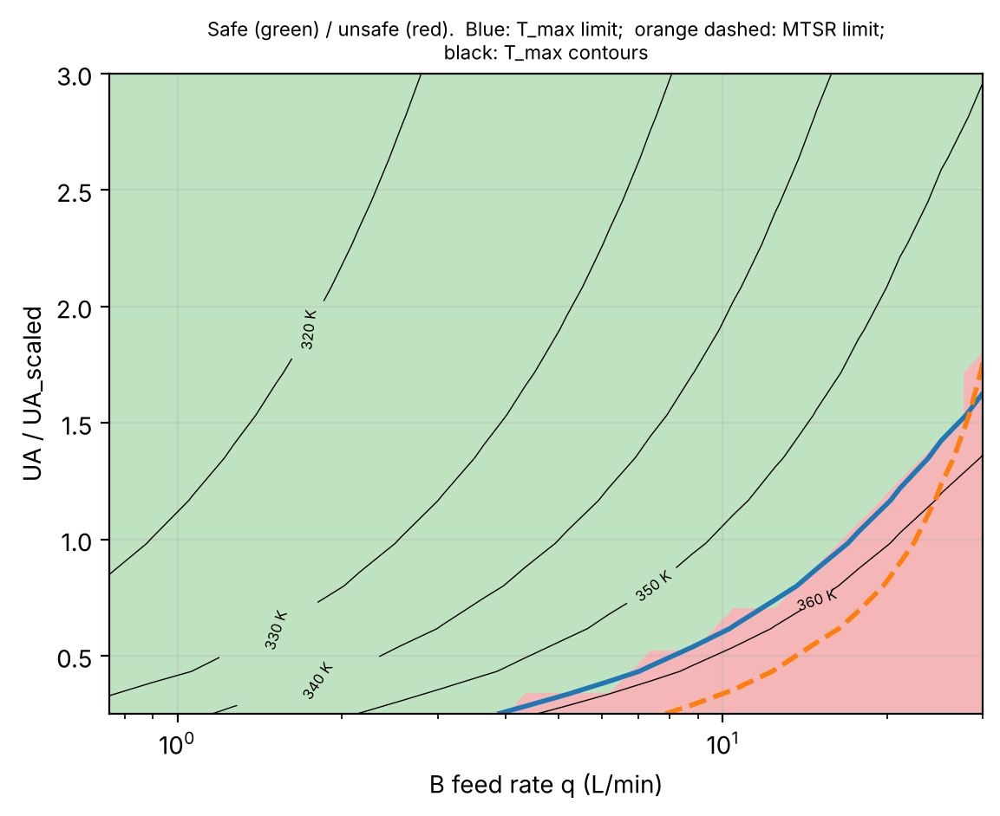

Runaway map over feed rate and jacket UA. Green: safe; red: unsafe. Blue line: peak-temperature limit; orange dashed: MTSR limit; black: peak-temperature contours.

### fig09_runaway_map_q_vs_Tc (Part 9)

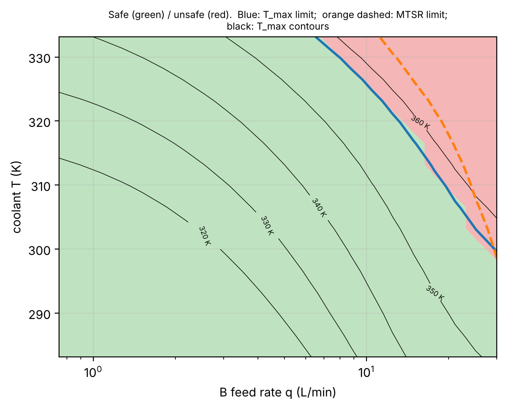

Runaway map over feed rate and coolant temperature, same colour code as fig08.

### fig10_conversion_vs_UA (Part 10)

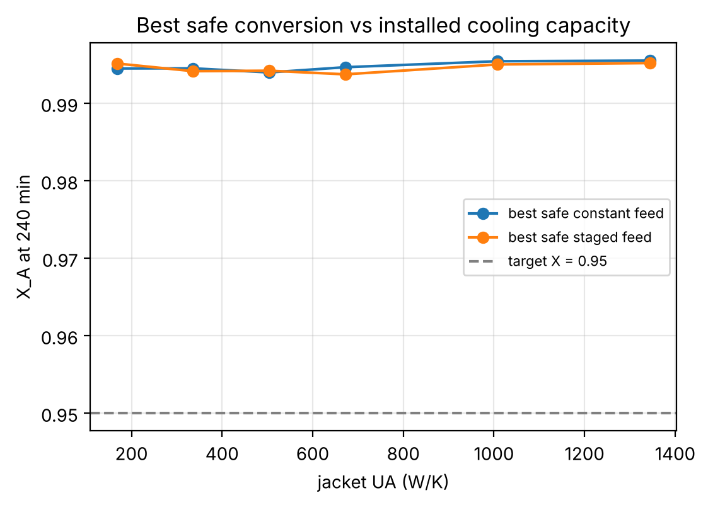

Best safe conversion reachable at each jacket UA. The recommended design is chosen at the installed jacket (config.UA_SELECTION).

**Finding: with the installed jacket the best safe conversion is X_A = 0.995.**

### fig11_recommended_design (Part 10)

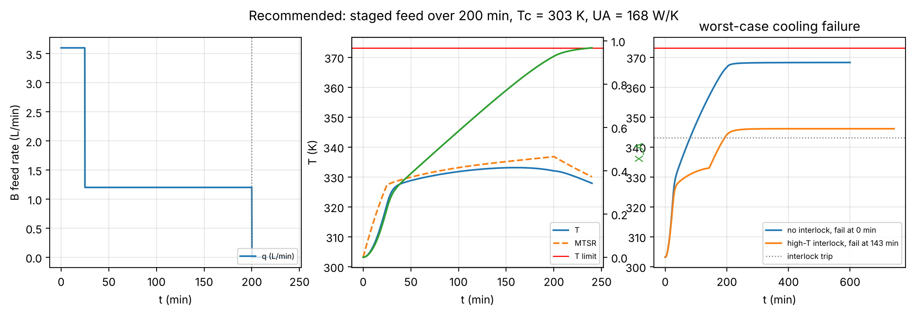

Recommended design: feed-rate schedule, temperature, MTSR and conversion in normal operation, and the worst-case cooling failure with and without the interlock.

**Finding: staged feed over 200 min, coolant 30 C, UA 168 W/K reaches X_A = 0.968; normal peak 59.9 C, MTSR 63.6 C; worst failure 95.1 C without and 73.0 C with the feed trip.**

### fig12_monte_carlo (Part 11)

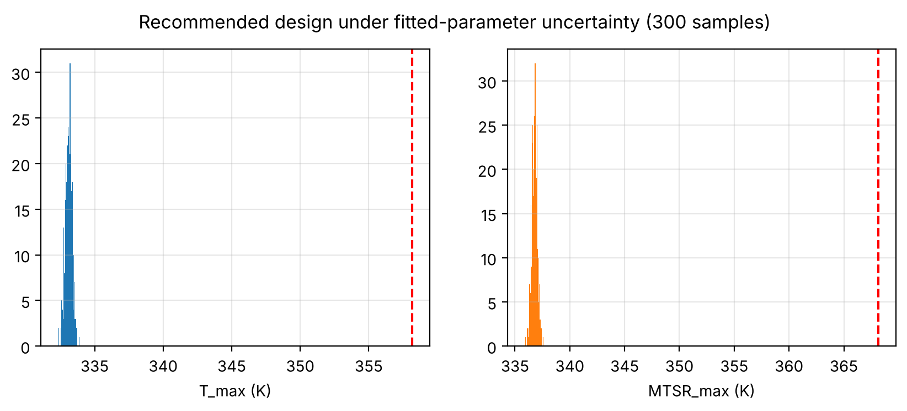

Monte Carlo over the fitted-parameter uncertainty: spread of conversion and MTSR for the recommended design.

**Finding: P(unsafe) = 0.0 % over the parameter covariance; 5th-percentile X_A = 0.967. Mixing and UA-scaling uncertainty are not sampled.**

## Tables

| File | Report | What it holds |
|---|---|---|
| [appendixE_worked_examples.json](tables/appendixE_worked_examples.json) | Appendix E | Numbers used in the hand calculations. |
| [part10_best_design_per_UA.csv](tables/part10_best_design_per_UA.csv) | Part 10 | Best design found at each jacket UA. |
| [part10_design_summary.json](tables/part10_design_summary.json) | Part 10 | Table 7: the recommended design. |
| [part10_recommended_cooling_failure.csv](tables/part10_recommended_cooling_failure.csv) | Part 10 | Cooling-failure scan for the recommended design. |
| [part11_sensitivity.csv](tables/part11_sensitivity.csv) | Part 11 | Effect of Ea +/- 10 % and UA - 20 % on the recommended design. |
| [part4_verification_checks.csv](tables/part4_verification_checks.csv) | Part 4 | Table 3: verification checks (conservation, analytic limits, tolerance convergence, MTSR consistency). |
| [part5_candidates_after_5_runs.csv](tables/part5_candidates_after_5_runs.csv) | Part 5 | Every candidate next run, ranked by information gain, after the safety screen. |
| [part6_fitted_parameters.csv](tables/part6_fitted_parameters.csv) | Part 6 | Table 5: fitted parameters with standard errors and 95 % CIs. |
| [part6_parameter_correlation.csv](tables/part6_parameter_correlation.csv) | Part 6 | Correlation between the fitted parameters. |
| [part6_truth_recovery_selftest.csv](tables/part6_truth_recovery_selftest.csv) | Part 6 | Self-test only: true parameters against the fitted 95 % CIs. |
| [part7_validation_errors.csv](tables/part7_validation_errors.csv) | Part 7 | Table 6: validation errors (RMSE, bias, peak error). |
| [part8_nominal_summary.json](tables/part8_nominal_summary.json) | Part 8 | Nominal full-scale case: conditions and key results. |
| [part9_cooling_failure_scan.csv](tables/part9_cooling_failure_scan.csv) | Part 9 | Outcome of cooling loss at each failure time. |
| [part9_feed_rate_scan.csv](tables/part9_feed_rate_scan.csv) | Part 9 | Peak temperature, MTSR and conversion for each feed time. |
| [part9_safety_summary.json](tables/part9_safety_summary.json) | Part 9 | Safety criterion, maximum safe feed rate, criticality class. |

### part4_verification_checks

| check                             | case       |      value |   tolerance | units    | passed   |
|:----------------------------------|:-----------|-----------:|------------:|:---------|:---------|
| N_A + N_C = N_A0                  | bench      |  4.441e-16 |      1e-06  | relative | True     |
| N_B + N_C = B fed                 | bench      |  4.441e-16 |      1e-06  | relative | True     |
| V = V0 + volume fed               | bench      |  9.437e-16 |      1e-06  | relative | True     |
| adiabatic energy balance          | bench      |  4.164e-10 |      1e-06  | relative | True     |
| isothermal post-feed analytic C_A | bench      |  1.306e-09 |      1e-05  | relative | True     |
| tolerance convergence: T          | bench      |  0.0003417 |      0.01   | K        | True     |
| tolerance convergence: X_A        | bench      |  5.613e-06 |      0.0001 | -        | True     |
| adiabatic failure T_final = MTSR  | bench      | -4.349e-11 |      0.05   | K        | True     |
| N_A + N_C = N_A0                  | full scale |  1.326e-15 |      1e-06  | relative | True     |
| N_B + N_C = B fed                 | full scale |  1.705e-15 |      1e-06  | relative | True     |
| V = V0 + volume fed               | full scale |  1.329e-15 |      1e-06  | relative | True     |
| adiabatic energy balance          | full scale |  3.804e-11 |      1e-06  | relative | True     |
| isothermal post-feed analytic C_A | full scale |  3.083e-10 |      1e-05  | relative | True     |
| tolerance convergence: T          | full scale |  4.904e-05 |      0.01   | K        | True     |
| tolerance convergence: X_A        | full scale |  2.388e-07 |      0.0001 | -        | True     |
| adiabatic failure T_final = MTSR  | full scale | -8.254e-11 |      0.05   | K        | True     |

### part7_validation_errors

| run   | variable   | units   |      RMSE |      bias |   max_abs_error |
|:------|:-----------|:--------|----------:|----------:|----------------:|
| V1    | CA         | mol/L   |   0.02924 |  0.007558 |         0.0661  |
| V1    | CB         | mol/L   |   0.03184 | -0.00596  |         0.1016  |
| V1    | CC         | mol/L   |   0.02923 |  0.005143 |         0.07723 |
| V1    | T          | K       |   0.524   | -0.02674  |         1.141   |
| V1    | T_max      | K       | nan       | -1.026    |       nan       |
| V1    | t(T_max)   | min     | nan       |  2.521    |       nan       |

### part11_sensitivity

| case          |   fixed_XA |   fixed_Tmax |   fixed_MTSR |   fixed_margin_K | fixed_safe   | reopt_policy   |   reopt_t_feed |   reopt_Tc |   reopt_UA_W_K |   reopt_XA | reopt_meets_target   |
|:--------------|-----------:|-------------:|-------------:|-----------------:|:-------------|:---------------|---------------:|-----------:|---------------:|-----------:|:---------------------|
| base          |     0.9676 |        333.1 |        336.8 |            25.05 | True         | staged         |            200 |      303.1 |          168.1 |     0.9676 | True                 |
| Ea -10%       |     0.963  |        332.9 |        337   |            25.27 | True         | staged         |            200 |      303.1 |          168.1 |     0.963  | True                 |
| Ea +10%       |     0.9716 |        333.3 |        336.6 |            24.86 | True         | staged         |            200 |      303.1 |          168.1 |     0.9716 | True                 |
| plant UA -20% |     0.9748 |        337.2 |        340.7 |            20.98 | True         | staged         |            200 |      303.1 |          134.4 |     0.9748 | True                 |

### part6_truth_recovery_selftest

| parameter     |   estimate |   ci95_low |   ci95_high |     true | true_inside_95CI   |
|:--------------|-----------:|-----------:|------------:|---------:|:-------------------|
| k_ref @ 310 K |    0.06789 |    0.06682 |     0.06897 |   0.0682 | True               |
| Ea            |   64.41    |   63.43    |    65.39    |  65      | True               |
| dH_rxn        |  -90.2     |  -91.59    |   -88.81    | -90      | True               |
